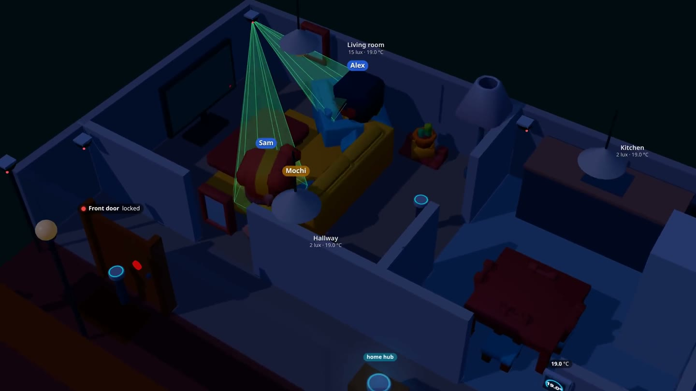

# Unspoken 默契

**A home that gets the hint. No wake word required.**

Created by **Anne**.

Unspoken is an interactive smart-home simulation. A real Strands Decider 2B interprets everyday speech and camera-scene descriptions; Claude Haiku 4.5 on Amazon Bedrock handles uncertain decisions. Plain-code rules decide whether an action is allowed, needs confirmation, or should be ignored.



Start at the welcome page to watch the [three-minute walkthrough](homedemo/web/static/assets/welcome/unspoken.mp4), then choose **Launch live demo**. The interactive page offers a 3D home, scenarios, a simulated phone, and an X-ray of each model decision.

## Try it locally

Python 3.11 or newer is required. Python 3.12 is used for the deployment scripts.

```bash
python3 -m venv .venv
. .venv/bin/activate
python -m pip install -e '.[dev]'
python -m homedemo --mode fake --port 8780
```

Open `http://127.0.0.1:8780` for the welcome page or `http://127.0.0.1:8780/demo` for the interactive home. **Fake mode uses scripted model responses** and requires no model server or AWS account. Sensors, people and device actions are simulated in every mode.

## Run real 2B + Haiku decisions

Run a [public Strands Decider](https://github.com/strands-labs/strands-decider) 2B model server at `http://127.0.0.1:8765`, and configure AWS credentials with access to Claude Haiku 4.5 on Bedrock in `us-west-2`.

```bash
export HOMEDEMO_ALLOWED_MODES=2b,cascade
export HOMEDEMO_ALLOWED_ESCALATIONS=bedrock
python -m homedemo --mode cascade --bedrock-profile "" --bedrock-region us-west-2
```

`--bedrock-profile ""` uses the standard AWS credential chain, including an instance role. To use a named local profile instead, pass `--bedrock-profile YOUR_PROFILE`. Bedrock model access and inference are configured and billed in your own AWS account.

For 2B inference without Bedrock, run with `--mode 2b`. See [model setup and hosting](docs/DEPLOYMENT.md) for the pinned model revisions, CPU memory requirements and Ubuntu installation scripts. Model weights are downloaded separately and are not included in this repository.

## How it works

```text
Simulated sensors → perception / voice → 2B judgment → Haiku when uncertain
                           │                       │
                     reflex rules ───────────→ policy → simulated devices / phone
```

The model proposes actions; policy code checks permissions and context before acting. TV and outside voices are identified separately. A keyword matcher runs alongside the models as a comparison and never controls devices.

- **Watch first:** a self-hosted video with playback, seeking and fullscreen controls.
- **Explore:** run the three-minute tour, choose individual scenarios, or type your own sentence.
- **Inspect:** see the request, confidence, model route, latency, tool calls and token usage.
- **Reuse:** [DeciderToolRouter](homedemo/patterns/README.md) is a small Strands intervention that can be used in another agent.

The deployed configuration uses 2B + Haiku. Historical evaluation files include other model comparisons; these are dated results, not claims about every machine or current model run. When hosted on a server, the 2B inference runs on that server. Requests that escalate are sent to Bedrock.

## Development

```bash
python -m pytest -q
python -m homedemo.scenarios
```

Tests use scripted models by default. Live integration tests require `HOMEDEMO_LIVE=1`, a running 2B server and, for the Bedrock test, AWS credentials. The tests are organized by simulator, bus, agents, scenarios, routing pattern and web interface. The recorded evaluation harness and results live in `eval/`.

A local web UI is bound to loopback. For public hosting, use a TLS reverse proxy; the app is a shared simulation and exposes state-changing demo controls. [Deployment documentation](docs/DEPLOYMENT.md) describes the supplied systemd/Nginx setup.

## Project layout

| Path | Purpose |
|---|---|
| `homedemo/sim/`, `bus.py`, `contracts.py` | Simulated home, event bus and contracts |
| `homedemo/agents/`, `decider/` | Model decisions, perception, policy and actuation |
| `homedemo/patterns/` | Reusable Strands tool router |
| `homedemo/scenarios/` | Scenario library, runner and checks |
| `homedemo/web/` | FastAPI, welcome page and 3D interface |
| `tests/`, `eval/` | Tests and evaluation tools |
| `deploy/` | Portable installation scripts and model memory optimization |

## License and credits

Project code and the walkthrough video are released under the [MIT License](LICENSE), copyright Anne. Vendored Three.js and the Kenney/KayKit assets retain their own licenses and credits in [third-party notices](homedemo/web/static/THIRD_PARTY_NOTICES.md). Strands, model weights and external dependencies retain their respective upstream licenses.
